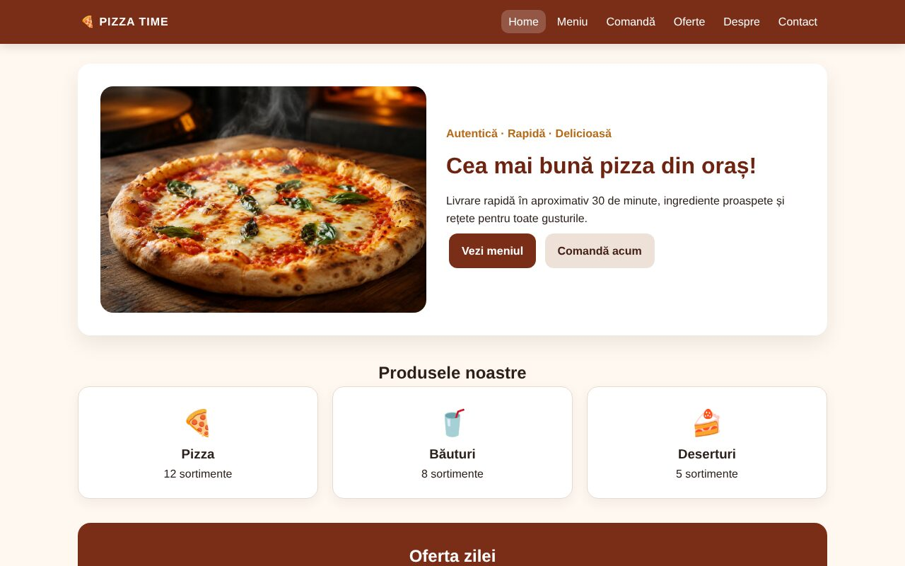
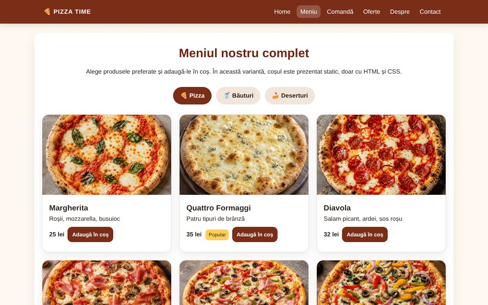
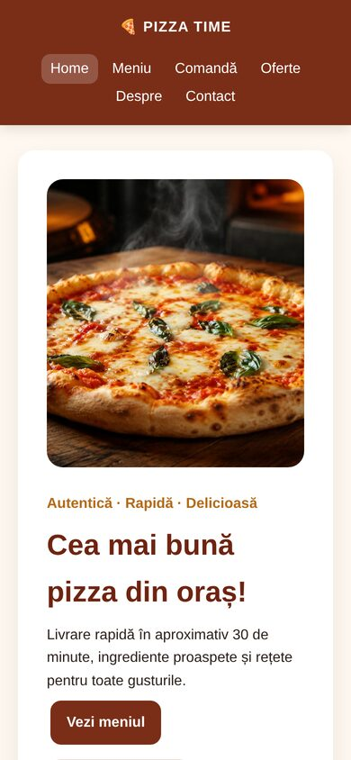

# Pizza Time – site de prezentare pentru o pizzerie

Site static cu 6 pagini, realizat **doar cu HTML și CSS** (fără JavaScript, fără framework-uri): prezentarea unui restaurant fictiv din Craiova, cu meniu, coș de comandă, oferte, pagină despre echipă și contact.

> Static 6-page restaurant website built with plain HTML and CSS only (no JavaScript): menu, order cart, offers, about and contact pages, responsive layout.

| Meniu | Mobil |
|---|---|
|  |  |

## Pagini

| Pagină | Conținut |
|---|---|
| `index.html` | prezentare, categorii de produse, oferta zilei |
| `meniu.html` | pizza (carduri cu imagini și prețuri), băuturi, deserturi |
| `comanda.html` | formular de comandă și coș static (eliminare / readăugare produse doar cu CSS) |
| `oferte.html` | promoții, cu fundaluri dedicate |
| `despre.html` | povestea restaurantului și echipa |
| `contact.html` | date de contact, hartă, locații, formular |

## Ce demonstrează

- HTML5 semantic (`header`, `nav`, `main`, `section`, `footer`)
- O singură foaie de stil externă (`css/style.css`), cu layout Flexbox / Grid
- Design responsive (desktop și mobil)
- Interacțiuni realizate doar cu CSS (stări active, coș static)

## Rulare

Nu necesită instalare: deschide `index.html` în browser.

Pentru publicare gratuită: în repository, **Settings → Pages → Branch: `main` / root**. Site-ul apare la `https://<utilizator>.github.io/pizza-time/`.

## Notă

Restaurantul, adresa, telefonul și emailul sunt **fictive**, create pentru proiect. Imaginile sunt generate cu AI.

## Context

Proiect realizat la disciplina SSM (HTML/CSS), Facultatea de Automatică, Calculatoare și Electronică (FACE), Universitatea din Craiova.
